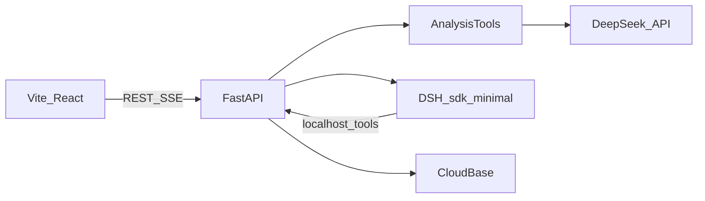

# 评见 MVP

这份是早期方案，不再决定当前行为。动态补分类和跳过选题的口径以 `docs/评见_实现复习.md`、`docs/评见_mvp_final.plan.md` 为准。

在当前仓库替换浏览器分析内核。环境 `cloud1-4grqnt5f5b5d8f20` 与 travel-cat、eatwhat 共用，只新建 `pingjian_*` 集合和 `pingjian/` 云存储目录，不读写 `users`、`players`、`cards`、`eatwhat_*`，也不改 `travel-cards/`、`audio/`。

密钥不写进代码。`.env` 继续忽略，补一份 [`.env.example`](.env.example)：`CLOUDBASE_ENV_ID=cloud1-4grqnt5f5b5d8f20`、`CLOUDBASE_API_KEY`、`DEEPSEEK_API_KEY`。缺密钥时服务能启动，健康检查标明缺哪一项；导入和分析在补齐前返回明确错误。

## 运行形态

本机前端仍用 Vite。后端和 DSH 跑在 Linux 容器里，因为本机是 macOS 12.1 / Python 3.8，而 `deepseek-harness-sdk` 需要 Python 3.10+ 和 Linux 或 macOS 14 运行时。



编排代理使用 `profile=sdk-minimal`、`model=deepseek-flash`、`reasoning_effort=high`。它按固定顺序各调用一次工具：`inspect_import`、`classify_comments`、`cluster_topics`、`rank_opportunities`、`draft_actions`、`commit_report`。分批调用 DeepSeek、计数和证据校验都在工具内部完成。分析请求的地址、参数和五段 prompt 见下文。报告只采用 `commit_report` 校验后的结构，不采用代理的自由文本。

DSH 工具是一个很小的 Cordis 插件，`execute` 用本机 HTTP 调用 FastAPI 的内部接口，请求头带进程内随机令牌。镜像构建时安装插件，并用 profile patch 去掉 `sdk-minimal` 自带的 shell，避免代理直接改容器。`on_notification` 把思考、工具开始和工具结束写成任务事件，再经 SSE 推到页面。

同一进程同时只跑一个分析，其余任务排队。页面刷新后读取已保存的任务和事件；进行中的流用 `fetch` 带 Bearer 重接，因为 `EventSource` 不能加鉴权头。

## 数据

登录走 CloudBase 账号密码。前端把账号密码交给 FastAPI，服务端调用 CloudBase `/auth/v1/signup` 和 `/auth/v1/signin`，之后用 Access Token 解析 `uid`。浏览器不持有管理员密钥，也不直接写数据库。

集合一律带 `uid`：

- `pingjian_videos`：视频元数据和清洗统计
- `pingjian_comments`：一条评论一个文档，只存一级评论
- `pingjian_tasks`：状态、进度、错误、排队顺序
- `pingjian_events`：思考和工具事件，单独存放，避免任务文档超限
- `pingjian_reports`：洞察、排序、可编辑建议、收藏标记

原始文件放在 `pingjian/imports/{uid}/{videoId}/`。控制台需要一次手工准备：打开用户名密码登录、填写两个密钥、把 `pingjian_*` 的客户端读写关掉。服务启动时若集合不存在则创建。

## 分析规则

导入复用 [`src/import/clean.ts`](src/import/clean.ts) 的规则，并改由 Python 作为唯一提交实现：识别这 19 个列名及其常见别名，对不上再手动映射；去掉空内容和重复评论 ID（保留点赞更高的一条）；丢掉非一级；低信息量评论保留但标出。样例 [`files/exportdou-6b7f0fec-f310-49a3-a302-8063863efc01.csv`](files/exportdou-6b7f0fec-f310-49a3-a302-8063863efc01.csv) 用作解析测试。预览可以在浏览器里做，提交时服务端重新解析。

标签四类，可多选：明确需求、常见问题、负面反馈、内容灵感。机会分由评论数、已核验证据比例、可行性、执行成本组成；后两项标为推断。每条洞察在落库前核对评论 ID 属于该用户该视频、引用是原文连续片段、条数等于 ID 数量。

建议卡片含选题、内容结构、目标需求、验证方式，并区分事实、推断、待验证假设。用户可改文字和收藏，不能直接改计数和评论 ID。导出由结构化字段生成 Markdown 和 CSV。

## DeepSeek API 与 Prompt

分析调用集中在 `server/deepseek.py`，提示词放在 `server/prompts.py`，版本号 `mvp-2` 写进任务和报告。`inspect_import` 和 `commit_report` 不调模型。其余五段都走官方 Chat Completions，由对应工具在内部顺序调用。

统一请求：

- `POST https://api.deepseek.com/chat/completions`
- `Authorization: Bearer $DEEPSEEK_API_KEY`
- `model` 固定 `deepseek-flash`（当前即 V4.1-Flash-1017）
- `stream: false`
- `thinking: {"type": "disabled"}`
- `response_format: {"type": "json_object"}`
- `temperature: 0.2`
- 超时 180 秒。JSON 无法解析，或返回没有覆盖全部输入 id 时，同一请求最多再试 1 次。第二次仍失败，任务记为失败，并写明停在哪一段、缺哪些 id。

用户消息只放 JSON。评论发给模型时只用 `id`、`likes` 和截断到 180 字的正文，不发昵称。证据核对用库里的全文。低信息量评论不发给模型，标签为空，只计入「未归类」。模型不写引用原文；事实只交评论 ID，服务端从对应全文截取不超过 40 字的摘录。

DSH 另有一段编排提示，不负责分类和选题。系统提示是：「你是评见的分析编排员。按照工具顺序各调用一次，不要自己统计条数，不要自己撰写报告。某一步失败就停止。工具全部成功后，用两句话说明做了什么。」用户提示只含 `taskId` 和视频标题。

五段分析如下。

定位，每个视频 1 次，放在 `classify_comments` 开头。输入是标题、话题标签，以及按点赞取前 30 条。`max_tokens` 800。

```text
你是抖音评论分析员。只输出 JSON，不要 markdown。
根据标题和高赞评论判断这条视频在讲什么。
vertical 不超过 12 字，format 不超过 12 字，topic 不超过 40 字。
boundaryNotes 最多 4 条，每条不超过 40 字，说明这条视频里怎样区分需求、问题、负面和灵感。
JSON：{"vertical":"","format":"","topic":"","boundaryNotes":[]}
```

分类，每批 40 条，按批顺序调用，每批完成后更新进度。`max_tokens` 4096。用户消息带上定位结果和本批评论。

```text
你给抖音一级评论打多标签。只输出 JSON，不要 markdown。
标签只有四个，可以多选，也可以为空：
need 明确需求：想要链接、价格、清单、教程、步骤、替代方案，或明确希望再拍什么。
question 常见问题：没看懂、问原因、问是否适用、求确认。
negative 负面反馈：指出错误、夸大、难用、太快、太长、货不对版、失望或投诉。
idea 内容灵感：给出可延伸的选题、场景、对比或下期方向，而且不是单纯抱怨。
只有调侃、表情、加油或 @朋友时，labels 用空数组。
求链接、求价格用 need。指出错误用 negative。单纯抱怨不要标成 idea。
含 need 或 question 时，groupKey 必填，为 2 到 8 个汉字，同义说法用同一个词。否则不要 groupKey。
JSON：{"items":[{"id":"","labels":["need"],"groupKey":"风衣链接"}]}
items 必须覆盖输入中的每一条 id。不要编造 id，不要输出输入之外的标签。
```

聚类，每个有至少 2 条实质评论的标签调用 1 次，最多 4 次。每次只送该标签下点赞最高的 60 条。主题条数等于校验后的 assignment 数量，并另存该标签的全量条数。`max_tokens` 2500。

```text
你在整理同一标签下点赞较高的评论。只输出 JSON，不要 markdown。
summary 不超过 40 字，只概括这些评论里反复出现的内容，不要写数字。
最多 5 个主题。name 是 2 到 8 个汉字，不要和标签同名，不要使用标点。
每条评论最多归入一个主题。不足 2 条的主题不要建立，对应评论的 theme 用空字符串。
theme 的 summary 不超过 30 字。
JSON：{"summary":"","themes":[{"name":"","summary":""}],"assignments":[{"id":"","theme":""}]}
assignments 只能使用输入中的 id。
```

排序，全视频 1 次。服务端先给每个通过校验的主题一个 `themeId`，并算好 `count` 和 `likeSum`。模型只评可行性和成本。`max_tokens` 2000。

```text
你只评估行动的可行性和执行成本。只输出 JSON，不要 markdown。
不要改 count，不要新增主题，不要写评论摘录。
feasibility 和 cost 都是 1 到 5 的整数。5 表示可行性高，或制作成本高。
reason 不超过 30 字，不要写输入里没有的数字。
JSON：{"items":[{"id":"","feasibility":3,"cost":2,"reason":""}]}
items 必须覆盖输入中的每一个主题 id。
```

服务端计算 `countNorm = min(count, 20) / 20`，`evidence` 为该主题中成功回填摘录的评论占比，`score = round(100 * countNorm * evidence * feasibility / cost)`。按 score 取前 8 个。`feasibility`、`cost` 和 `reason` 标为推断，`count` 与 `evidence` 标为事实。

选题，全视频 1 次，输入是前 8 个主题及其 `count`、`likeSum`、最多 3 个已核验的评论 ID。`max_tokens` 4000。

```text
你给创作者写下一条内容的行动建议。只输出 JSON，不要 markdown。
每个主题一条。topic 不超过 30 字。
structure 是 3 到 5 个内容段落，每段不超过 20 字，只写结构，不写完整口播。
targetNeed 不超过 40 字。validation 不超过 40 字，说明下一条发出后看哪类评论来验证。
claims 最多 4 条。kind 只能是 fact、inference、hypothesis。
fact 必须从该主题给定的 commentIds 中引用，并且只陈述这些评论里已经出现的意思或给定的 count、likeSum。
inference 是基于这些评论做出的判断。hypothesis 是评论尚未证明的拍法假设。
不要编造评论、昵称和数字。
JSON：{"items":[{"themeId":"","topic":"","structure":[],"targetNeed":"","validation":"","claims":[{"kind":"fact","text":"","commentIds":[]}]}]}
```

落库前再核一遍：事实引用的 ID 必须属于该主题；摘录必须是全文里的连续内容；主题条数必须等于校验后的 ID 数。不符合的 fact 降为 inference 并去掉 ID。没有任何有效主题时，任务失败，原因为「没有足够的评论形成选题」。

## 界面

替换 [`src/App.tsx`](src/App.tsx)、[`src/components/Stage.tsx`](src/components/Stage.tsx)、[`src/db/idb.ts`](src/db/idb.ts) 和 [`src/ai/pipeline.ts`](src/ai/pipeline.ts)。新界面四块：登录注册、报告列表、导入向导、分析工作台。工作台显示任务进度、DSH 步骤、分类统计、机会排序、原始评论证据，以及可编辑建议。

登录后的壳层按参考图做成左右结构，桌面优先：

- 左侧固定栏，约 240px。顶部是「评见」。下面是「工作台」和「导入」。再下面是当前用户的报告列表，每条显示标题和灰阶状态。底部是账号和退出。当前项用浅灰底、黑字，栏内用细分隔线分组。
- 右侧是内容区。页面底为浅灰，内容放在白卡片里，卡片之间留出间距，圆角和细边框。顶栏左侧是页面标题和一行说明，右侧是报告搜索和黑色主按钮「导入」。
- 工作台在右侧用卡片网格：上方是分类统计，中间是分析进度和 DSH 步骤，下方左侧是机会与可编辑建议，右侧是原始评论证据。统计用灰条和数字，证据用列表。
- 导入向导也放在右侧内容区，沿用同一套顶栏和白卡片，不另做一套视觉。
- 宽度不足时，左栏收到顶部，卡片改成单列。

配色只使用黑、白、灰。页面底约 `#f5f5f5`，卡片和侧栏为白，主文字 `#111`，次文字 `#666`，边框 `#e6e6e6`。主按钮黑底白字，次按钮白底灰边。状态、分类和图表都用灰度区分，不用参考图里的蓝、绿、黄、红。不照搬参考图的英文品牌、销售数字和彩色图表。

登录和注册是居中的白卡片，使用同一套黑白灰，不显示左侧栏。

[`server/main.py`](server/main.py) 从 DeepSeek 代理改成业务 API。旧的 `/api/json` 和 `/api/narrative` 删除。

## 这次不包含

云托管控制台发布只留 Dockerfile 和部署时要设的最小实例数 1。不做微信登录、回复评论、报告分享、权重调节界面和多分析并行。
