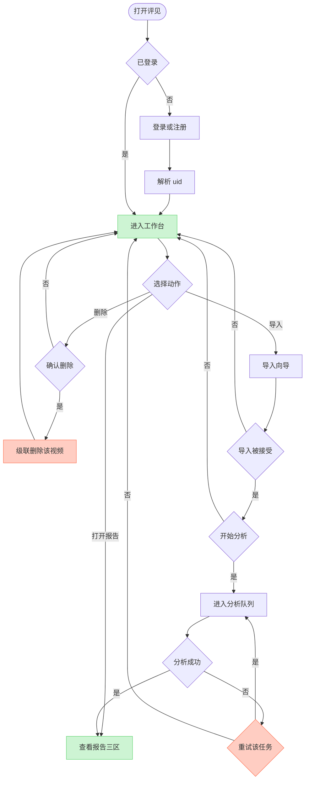
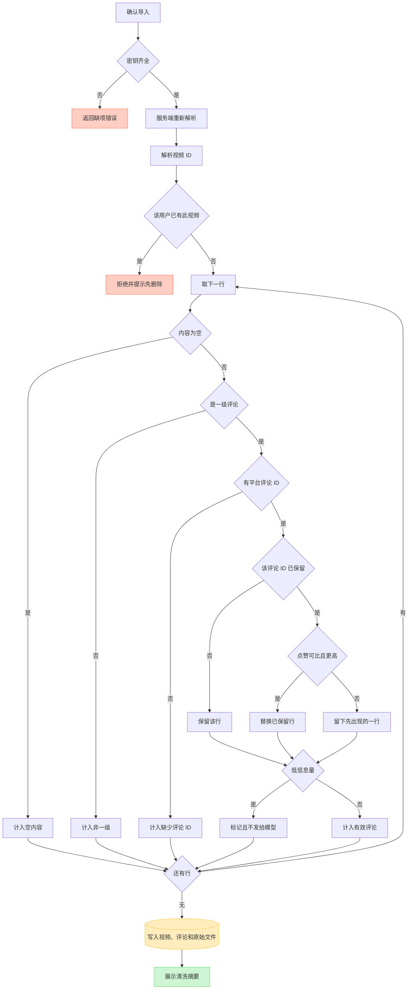
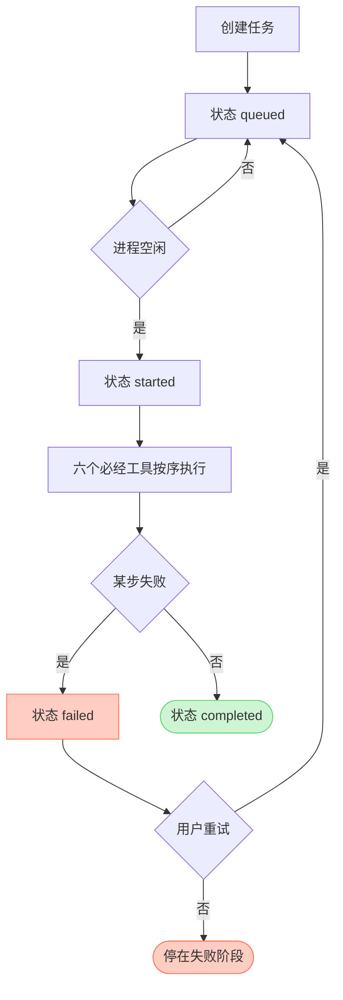
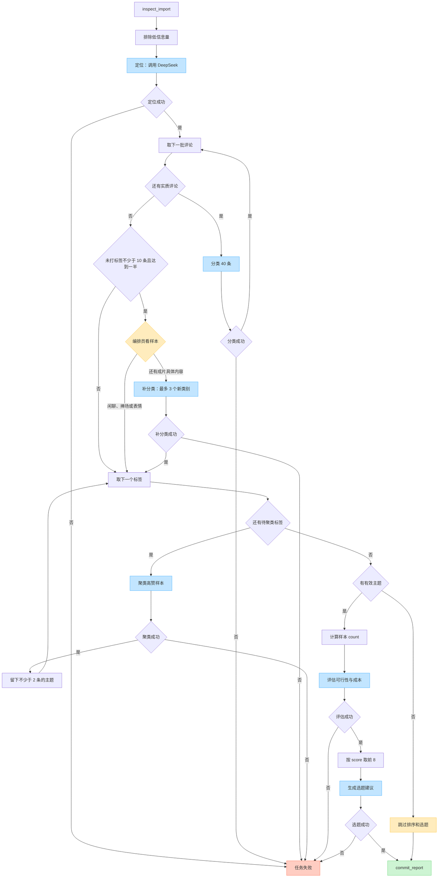
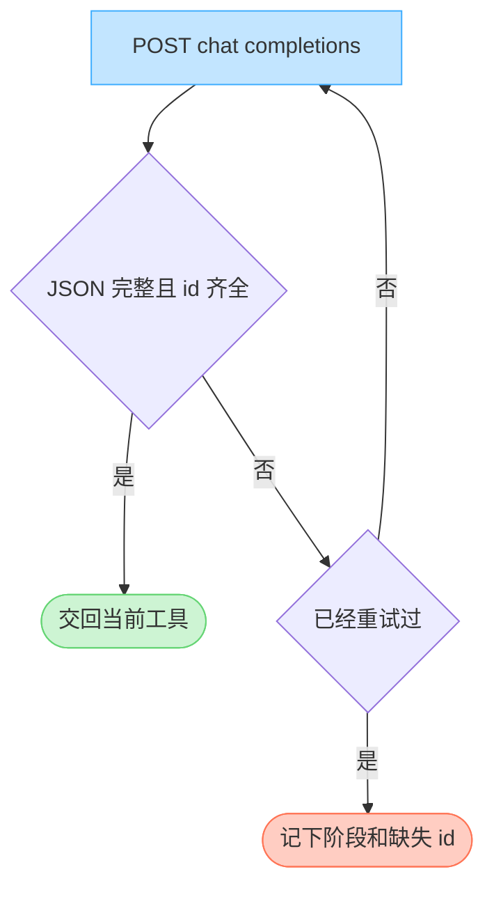
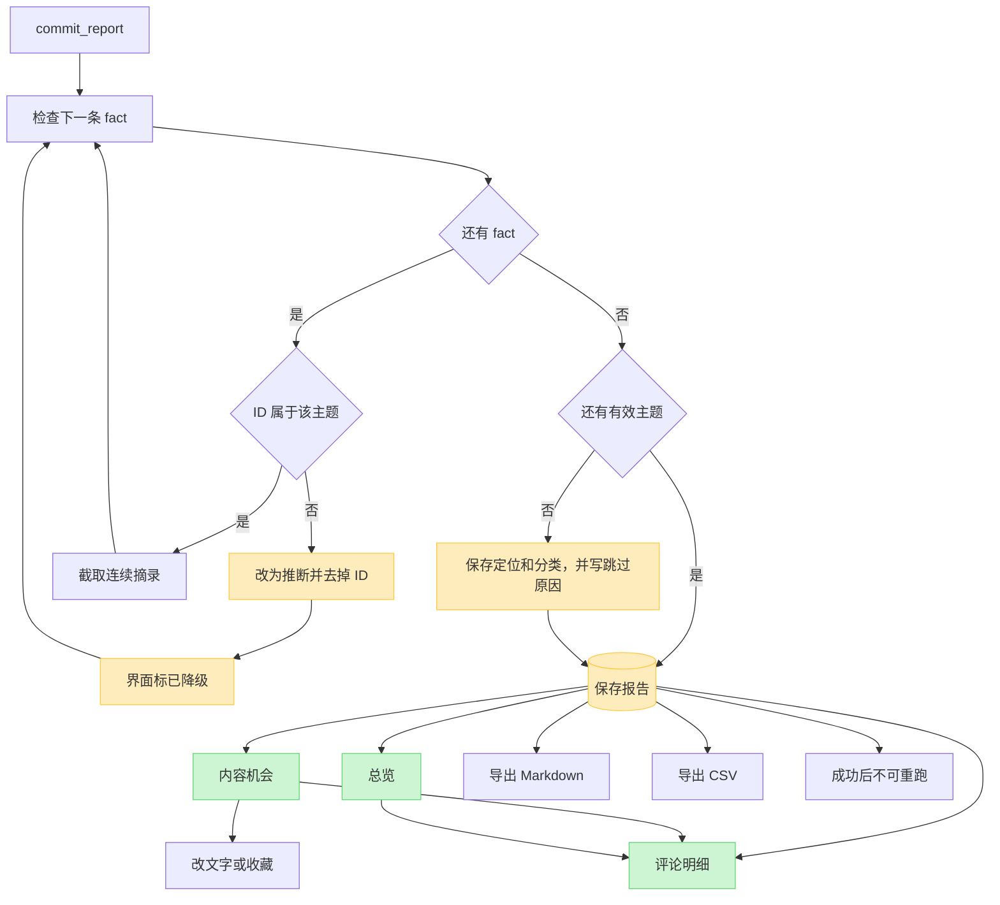
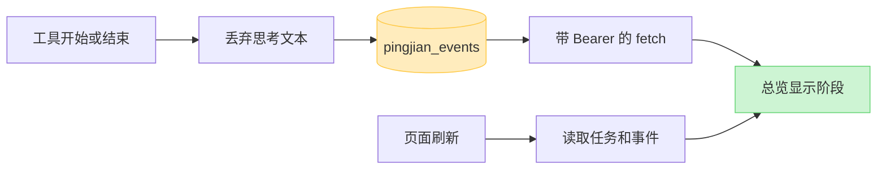

# 评见 MVP 流程图

实现以 [评见_mvp_final.plan.md](评见_mvp_final.plan.md) 为准。下面按真实分支画出主路径、导入、分析、模型重试、报告校验和事件推送。蓝色是 DeepSeek 调用，红色是失败或拒绝，绿色是落库或完成。

## 1. 主路径

删除按 `uid` 和 `videoId` 清掉评论、任务、事件、报告和原始文件。失败任务可以重试，仍使用已导入评论。成功后没有重新分析入口。

## 2. 导入与清洗

浏览器可以先做列映射和样例预览。提交后只认服务端重新解析的结果。

摘要分开计数：原始记录、有效评论、重复、空内容、非一级、低信息量、缺少评论 ID。低信息量评论保留，标签为空，计入未归类。

## 3. 分析队列

同一进程同时只跑一个分析。思考文本在写入事件前丢弃。

## 4. 工具链

必经顺序：`inspect_import`、`classify_comments`、`cluster_topics`、`rank_opportunities`、`draft_actions`、`commit_report`。分类和聚类之间可以插入一次 `reclassify_other`。`inspect_import` 和 `commit_report` 不调用模型。图中的 DeepSeek 节点都走第 5 节的重试规则。

定位每个视频 1 次。输入是标题、话题标签和点赞前 30 条；文件里有视频描述则一并传入。

分类只送给有实质内容的评论，每批 40 条。`groupKey` 只在标签含 `need` 或 `question` 时保留，为 2 到 8 个汉字。全部批次结束后，服务端统计未打标签的有效评论。不少于 10 条且达到有效评论的一半时，摘要写「可以考虑补分类」，并附上点赞最高的 12 条样本。否则写「不要补分类」。

补分类最多一次。编排员先看样本：大多是闲聊、捧场或表情就跳过；还有成片具体内容才调用。服务端在未达条件、重复调用或聚类已开始时拒绝，且不调用模型，任务继续。真正调用时只送未打标签评论里点赞最高的 80 条。模型自己归纳最多 3 个新类别，不写回四个预设标签。不足 2 条的类别丢掉，留下的以 `other` 并入后面的主题。

聚类每个够 2 条的标签 1 次，最多 4 次。每次只送该标签点赞最高的 60 条。主题条数等于校验后的样本归属数，并另存该标签全量条数。全量条数只展示，不进入 `score`。没有任何主题时，排序和选题跳过，报告仍提交，并写明已跳过。

`countNorm = min(count, 20) / 20`。`evidence` 是该主题里成功回填摘录的评论占比。`score = round(100 * countNorm * evidence * feasibility / cost)`。`count` 和 `evidence` 是事实；可行性、成本和原因是推断。

## 5. 单次 DeepSeek 请求

模型名取 `DEEPSEEK_MODEL`，缺省 `deepseek-flash`。非流式，JSON 模式，`temperature` 0.2，超时 180 秒，关闭 thinking。评论只传 `id`、`likes` 和截断到 180 字的正文，不传昵称。正文按不可信数据处理。提示词版本记为 `mvp-5`。补分类同样走这条请求，`max_tokens` 4096。

## 6. 报告校验与使用

模型不写摘录。服务端从全文截取连续的、不超过 40 字的片段。主题条数以校验后的评论 ID 数为准。

事实 ID 还必须属于当前用户和当前视频。可改的是选题、结构、目标需求、验证方式和主张文字。计数、评论 ID 和摘录只读。导出使用已保存、且已含用户编辑的报告，不带密钥、其他用户数据和内部事件。

总览展示原始记录、有效评论、主题数、提问数、消极反馈数和未归类。四个标签的条数分开显示。补分类形成的类别放在「其他」。评论明细可按关键词、标签、主题、是否被引用筛选。

## 7. 事件推送

事件类型有 `queued`、`started`、`stage_started`、`stage_completed`、`summary`、`completed`、`failed`。失败步骤保持失败状态。
